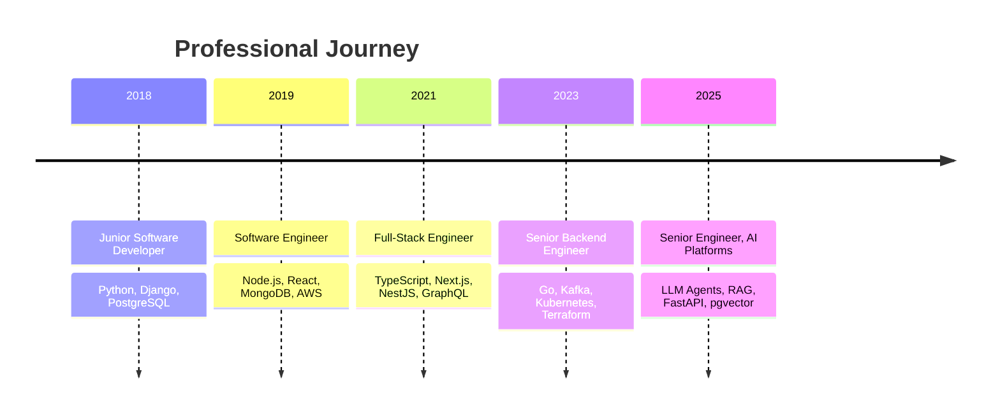

<!-- HEADER -->
<div align="center">


<a href="https://github.com/shoaibismailgit">
  
</a>

<br/>


</div>

---

## 👨‍💻 About Me

```python
class ShoaibIsmail:
    role       = "Senior Software Engineer"
    experience = "2018 – Present"
    focus      = ["Backend Systems", "Full-Stack Apps", "AI Agents & RAG"]
    languages  = ["Python", "TypeScript", "Go", "SQL"]
    cloud      = ["AWS", "Docker", "Kubernetes", "Terraform"]
    philosophy = "Make it work, make it right, make it fast."

    def current_mission(self):
        return "Building reliable, scalable and intelligent software."
```

I design and ship production systems end to end: from polished React/Next.js frontends to high-throughput Go and Python services, cloud infrastructure and LLM-powered agents.

---

## 📈 Career Timeline



📄 Full details → [EXPERIENCE.md](./EXPERIENCE.md)

---

## 🛠️ Tech Arsenal

<div align="center">

**Languages**


**Frontend & Backend**


**Data & Messaging**


**Cloud & DevOps**


</div>

📚 Full breakdown → [TECH_STACK.md](./TECH_STACK.md)

---

## 🚀 Featured Work

| Project | Description | Stack |
|---|---|---|
| 🤖 **AI Agent Platform** | Multi-agent workflows with tool calling, memory and RAG | Python · FastAPI · pgvector · Redis |
| ⚡ **Event-Driven Order Platform** | High-volume order & payment event processing | Go · Kafka · PostgreSQL · K8s |
| 📊 **Operations Dashboard** | Real-time analytics and admin portal with RBAC | Next.js · NestJS · GraphQL |
| 🔔 **Realtime Notification Service** | WebSocket messaging backend | Node.js · Redis · MongoDB · AWS |

🗂️ More → [PROJECTS.md](./PROJECTS.md) · Repos: [`vagent_co`](https://github.com/shoaibismailgit/vagent_co) · [`pyquil`](https://github.com/shoaibismailgit/pyquil) · [`exatorrent`](https://github.com/shoaibismailgit/exatorrent)

---

## 📊 GitHub Analytics

<div align="center">


</div>

---

## 🐍 Contribution Snake

<div align="center">
  <picture>
    <source media="(prefers-color-scheme: dark)" srcset="https://raw.githubusercontent.com/shoaibismailgit/shoaibismailgit/output/github-snake-dark.svg" />
    <source media="(prefers-color-scheme: light)" srcset="https://raw.githubusercontent.com/shoaibismailgit/shoaibismailgit/output/github-snake.svg" />
    
  </picture>
</div>

---

## 🔭 Currently Exploring

- 🤖 Autonomous AI agents & tool-calling workflows
- 🦀 Rust and WebAssembly for performance-critical tooling
- ⚛️ Quantum programming with Python
- 🏗️ Distributed systems & platform engineering

## 🤝 Connect

<div align="center">

[](https://github.com/shoaibismailgit)

<br/>


</div>
